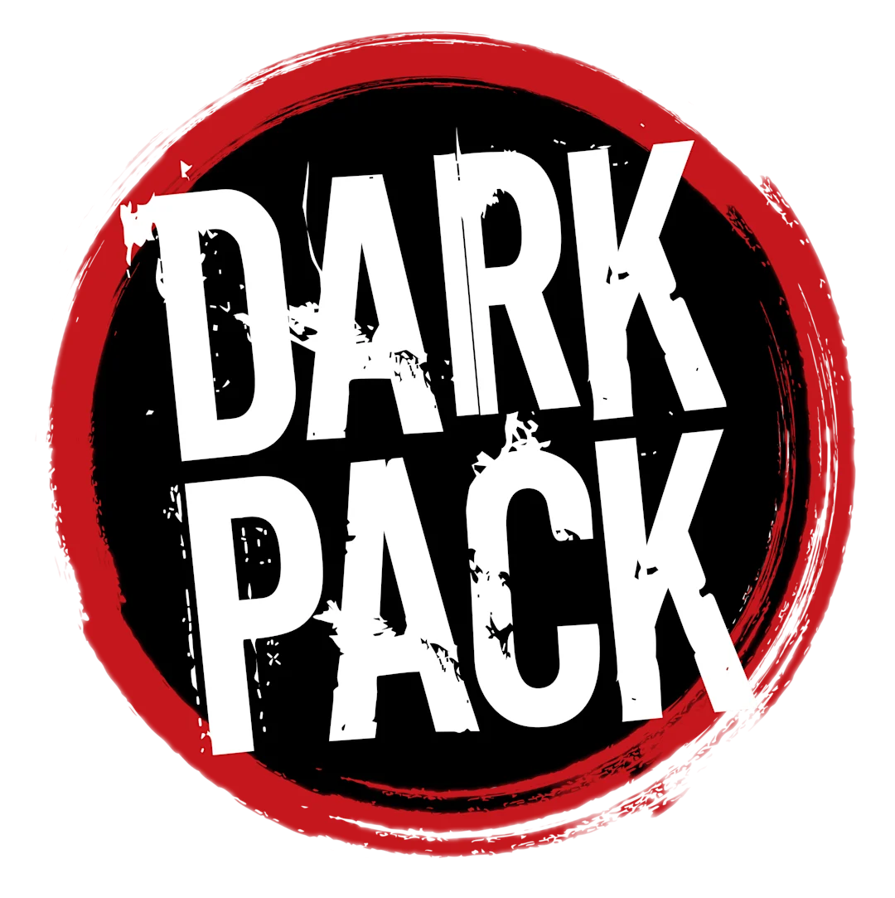

# Tableau de liège — VtM V5

Outil web fait maison pour MJ de Vampire : la Mascarade V5. Site statique : importer le dépôt sur Vercel (ou tout hébergement statique), sans réglage.

---

## Licence et mentions

Code sous licence MIT (voir `LICENSE`) — libre de le reprendre et de l'adapter. Les images et musiques incluses ne sont pas couvertes par cette licence.

Contenu non officiel, créé par une fan, gratuit et non commercial, dans le cadre du [Dark Pack](https://www.paradoxinteractive.com/games/world-of-darkness/community/dark-pack-agreement). Ce n'est pas du matériel officiel World of Darkness.
Portions of the materials are the copyrights and trademarks of Paradox Interactive AB, and are used with permission. All rights reserved. For more information please visit [worldofdarkness.com](https://www.worldofdarkness.com).
